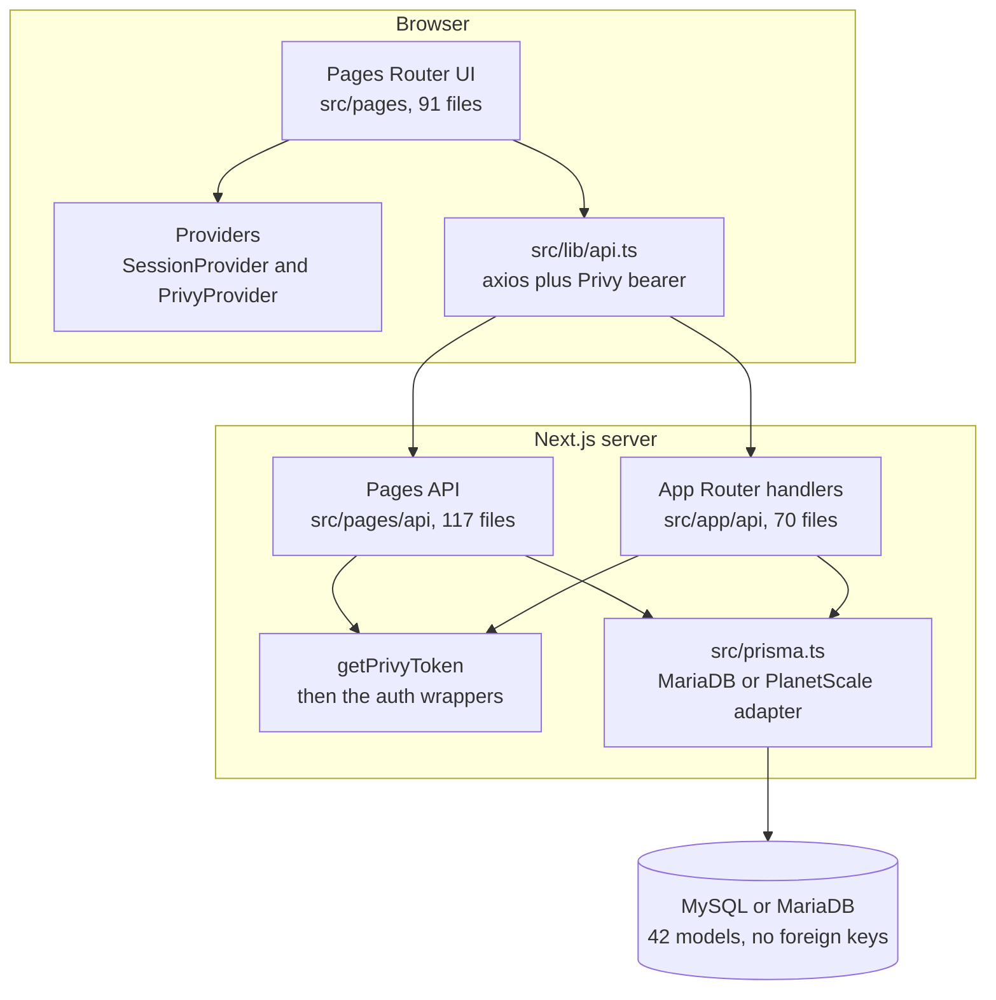
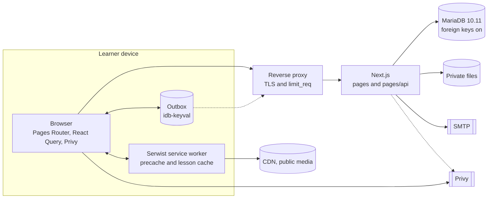
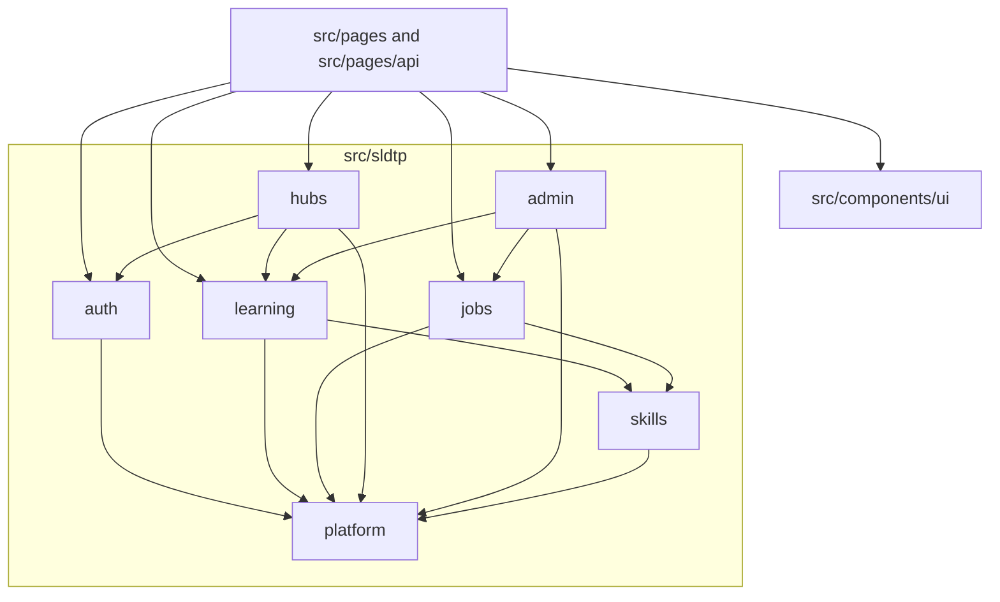

# Components

Checked against `integration` at `b6c208cf6`. **Planned** sections are the beta. The delete list and the allowlist are in [strip-map.md](../strip-map.md).

## Current

Counts are files on this head. The 91 page files include `_app.tsx` and `_document.tsx`. The 70 App Router handlers are `route.ts` under `src/app/api`. Outside that folder, `src/app` also has `robots.txt/route.ts`, `.well-known/agent.json/route.ts`, and `sitemap.ts`. None of those are pages.

`next-pwa` is wired in `next.config.ts` (`dest: 'public'`). Its only runtime rules are `NetworkOnly` for `/docs-keep`. No `public/sw.js` is committed. [ADR-0011](../adr/0011-offline-learning-service-worker.md) replaces it with Serwist.

Two routers means two request types. Pages routes use wrappers such as `withAuth`. App Router handlers use `getUserSession`. Both call `getPrivyToken`.

## Planned containers

[ADR-0014](../adr/0014-pages-router-only.md) leaves one router. Offline learning uses Serwist and an `idb-keyval` outbox ([ADR-0011](../adr/0011-offline-learning-service-worker.md)). The reverse proxy terminates TLS and applies `limit_req` ([ADR-0013](../adr/0013-no-queue-no-redis.md)).

## Planned modules

Everything we build lives in `src/sldtp/` ([ADR-0009](../adr/0009-src-sldtp-module-boundary.md)). Pages and API routes stay thin. Modules call each other through `index.ts`. `platform` imports no domain module. `platform/env.ts` reads env once. The Privy client is created lazily, so `next build` does not need secrets.

`auth` maps a Privy token to `User` and a role. `learning` owns courses, quizzes, sync, and certificates. `jobs` owns employers, opportunities, applications, and matching. `hubs` owns the roster, CSV import, and attendance. `platform` owns the database client, env, mail, audit, i18n, and media URLs.
