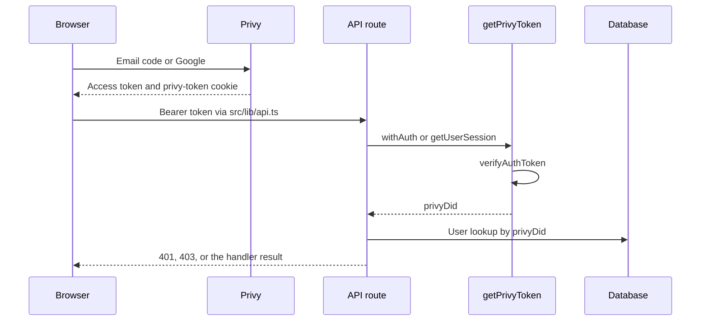
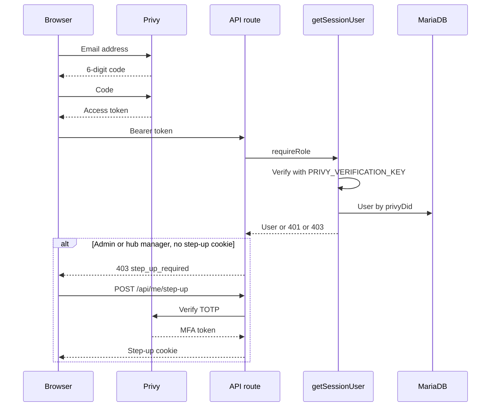
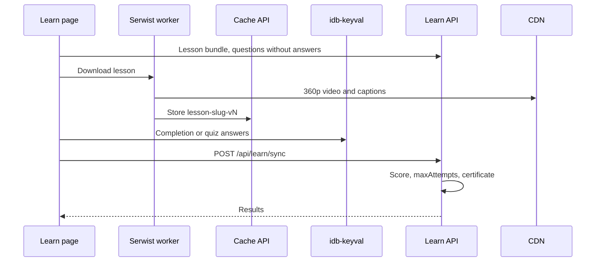
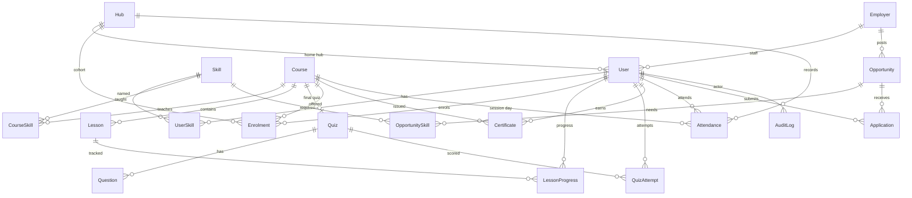

# Data flow

Checked against `integration` at `b6c208cf6`. **Planned** sections describe the beta. The field list is [data-model-final.md](../data-model-final.md).

## Current login

`getPrivyToken` reads `Authorization` first and the `privy-token` cookie second, then calls `privy.utils().auth().verifyAuthToken`. The client is the module-level `PrivyClient` in `src/lib/privy.ts`. First login today is `POST /api/user/create`, which creates the `User` row from `privyDid`.

`User.role` is a free string. The super-admin check is `role === 'GOD'`. Employer membership is `UserSponsors` plus `User.currentSponsorId`. The next-auth `Account` and `Session` models hang off `People`, not `User`.

## Current data

`prisma/schema.prisma` has 42 models. `relationMode = "prisma"`, so MariaDB does not enforce foreign keys. There is no migrations directory. The root README still documents `prisma db push` for this inherited schema. [ADR-0005](../adr/0005-mariadb-prisma-migrations-only.md) replaces that with a fresh baseline and migrations only.

`User.privyDid` is required and unique. `Bounties` and `Submission` are the listing and application tables this product will not adapt ([ADR-0010](../adr/0010-build-jobs-module-fresh.md)).

## Planned login

[ADR-0006](../adr/0006-identity-with-privy-roles-in-sldtp.md). Email one-time code for every role. Google comes out of `loginMethods`. Admin and hub manager then pass a TOTP step-up through Privy's server-side MFA API, after a week-1 spike. The spike stops if enrolment needs an embedded wallet.

The step-up cookie is `HttpOnly`, bound to `privyDid` and the Privy session id. Hub CSV import pre-creates the Privy user by email, then the `User` row.

## Planned offline learning

[ADR-0011](../adr/0011-offline-learning-service-worker.md). Apply, employer, hub, and admin screens stay online.

Progress keeps the earliest `completedAt`. Attempts past `maxAttempts` are stored as `overLimit`. If the Privy session expired offline, the outbox waits until the next sign-in.

Course completion is every lesson complete and the quiz passed. The learner signs in with the Privy email code.

## Planned domain model

19 tables, real foreign keys. Fields, delete rules, and the inclusion view are in [data-model-final.md](../data-model-final.md). The schema draft is [docs/data/schema.prisma](../data/schema.prisma).

Application status on the approved model is `SUBMITTED`, `IN_REVIEW`, `INTERVIEW`, `HIRED`, `REJECTED`, `WITHDRAWN`.

## Planned API

All under `src/pages/api/`.

| Prefix | Who | Role |
| --- | --- | --- |
| `/api/me` | signed in | Current user. First login provisions the row. Step-up routes are for admin and hub manager. |
| `/api/learn/*` | learner | Catalogue, enrol, lesson, progress, quiz, sync, certificate PDF |
| `/api/verify/[serial]` | public | Certificate check |
| `/api/jobs/*` | public read, learner apply | Opportunities and applications |
| `/api/employer/*` | employer | Profile, opportunity CRUD, review queue |
| `/api/hub/*` | hub manager | Roster, CSV import, attendance, CSV reports |
| `/api/admin/*` | admin | Users, approvals, skills, audit |
| `/api/health` | proxy and deploy | Database ping |
