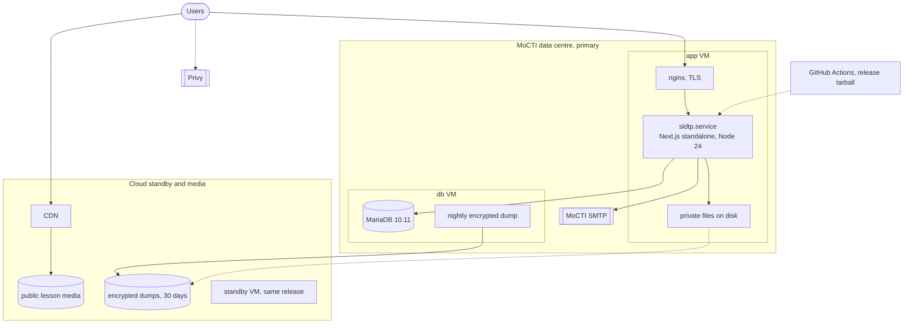
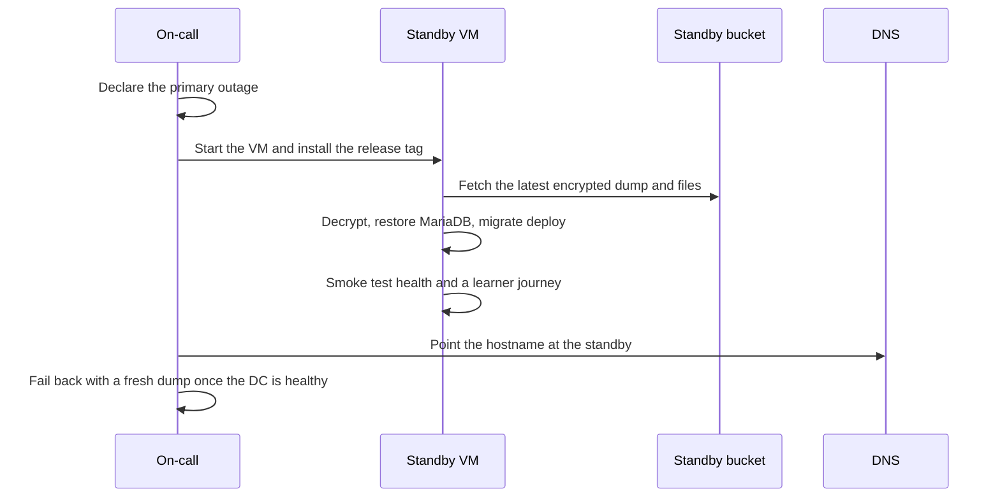

# Deployment

Checked against `integration` at `b6c208cf6`. **Planned** sections are [ADR-0004](../adr/0004-hosting-on-prem-primary-cloud-standby-cdn.md). Nothing in this repository deploys an on-prem site yet.

## Current

GitHub Actions (`.github/workflows/ci.yml`) runs on pull requests and on pushes to `main` and `integration`. Both jobs use Node 22 and pnpm 10, and install with `pnpm install --frozen-lockfile`. The `check` job typechecks and runs `scripts/sldtp/upstream-triage.py --check-imported`. The `audit` job is non-blocking.

`vercel.json` rewrites `/build` and `/hackathon` to `superteam.fun`, and its install command is `pnpm install --frozen-lockfile`. `next.config.ts` rewrites `/docs-keep/*` to PostHog and `/cdn/*` to third-party CDNs. The CSP names Privy, Solana, PostHog, Sumsub, WalletConnect, Cloudinary, and `wss://earn-vibe-production.up.railway.app`.

There is no `Dockerfile`, Compose file, `deploy.sh`, `.nvmrc`, or `ops/` tree. `next.config.ts` does not set `output: 'standalone'` or `images.unoptimized`.

`docs/strip/check-strip.mjs` is not a CI job.

## Planned normal operation

Primary site at the MoCTI data centre. One app VM and one database VM. Public lesson media on object storage behind a CDN. Nightly encrypted dumps and private files go to a standby bucket. The standby VM stays stopped or minimal and runs the same release tag.

ADR-0004 names Node 24 LTS for `sldtp.service`. On 27 Nov 2026 Node 24 is Maintenance LTS. Active LTS is Node 26. CI on this head is Node 22. The plan stays Node 24 until ADR-0004 changes. See [ADR-0019](../adr/0019-future-of-work-project-stack.md).

Rejected for production: Docker, Kubernetes, PM2, a load balancer, and live replication. Compose is for local development only.

## Planned failover

Manual, by runbook. Proposed targets for the Inception Report: RPO 24 hours, RTO 8 hours in working hours. Restore is tested before UAT and then each quarter. Active-active is rejected.

Media keeps serving during failover because it is already on the CDN.

`deploy.sh` unpacks the CI tarball into `releases/<tag>`, runs `prisma migrate deploy`, switches the `current` symlink, restarts the service, and curls `/api/health`. Rollback is the previous symlink. Migrations stay additive inside a release.

## Planned data residency

| Data | Where | Personal data | Safeguard |
| --- | --- | --- | --- |
| Learner, employer, application, attendance, audit | MoCTI MariaDB | Yes | Primary home |
| CVs, employer logos, certificate PDFs | App VM disk | Yes for CVs and certificates | Never on the CDN |
| Lesson video, captions, lesson PDFs | Object storage and CDN | No | Public course content. The import script refuses other files |
| Nightly dumps and private-file copies | Standby bucket | Yes, encrypted | Encrypted before upload. MoCTI holds the key outside the cloud account |
| Email address, Privy user id, login metadata | Privy | Yes | [ADR-0017](../adr/0017-privy-saas-identity-and-data-residency.md). Open against the ToR data-centre wording |

Provider, region, and the standby quote are still open. Privy's Core tier is about $299 a month at 500 to 2,499 monthly active users, from the pricing page cited in ADR-0017 on 27 Nov 2026.
