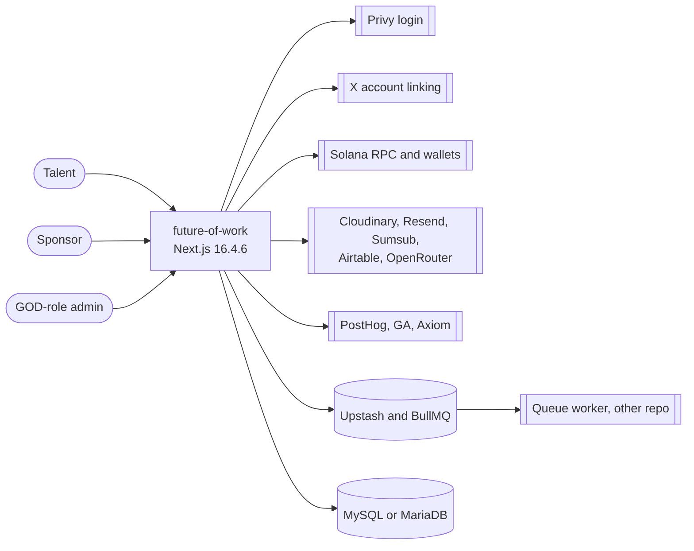
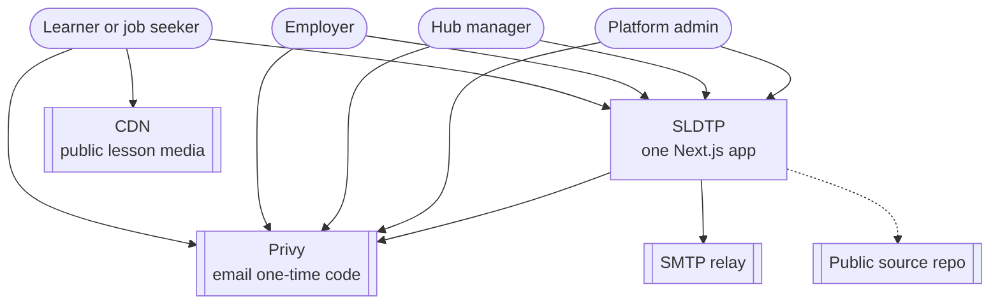

# System context

Checked against `integration` at `b6c208cf6` (27 Nov 2026). **Planned** sections are the March 2027 beta from the accepted ADRs. They are not built.

The inherited app is one Next.js 16.4.6 process (React 19.2.4, TypeScript 5.8.3, Tailwind 4). Every UI page is the Pages Router. Identity for login is Privy. Data is Prisma 7.4.2 on MySQL, with a MariaDB adapter and a PlanetScale adapter in `src/prisma.ts`. Around that core the tree still calls Solana, Cloudinary, Resend, Upstash, BullMQ, PostHog, Airtable, Sumsub, OpenRouter, and other SaaS. `src/sldtp/` does not exist yet.

## Current

Checked details:

- Login is Privy. `src/components/providers.tsx` mounts `PrivyProvider` with `loginMethods: ['email', 'google']`. [ADR-0006](../adr/0006-identity-with-privy-roles-in-sldtp.md) plans email only.
- `next-auth` 4.24.15 is only the X link. `src/pages/api/auth/[...nextauth].ts` uses `TwitterProvider` and writes `linkedTwitter` on the Privy user. `SessionProvider` is mounted from `src/pages/_app.tsx`.
- `src/lib/privy.ts` constructs `PrivyClient` at import, with `NEXT_PUBLIC_PRIVY_APP_ID`, `PRIVY_APP_SECRET`, and `PRIVY_VERIFICATION_KEY`. `src/lib/redis.ts` throws at import when the Upstash env vars are missing.
- `src/app/api/dev-tool/dummy-submissions` is not in the tree. It was removed before this head.
- Server auth goes through `getPrivyToken` in `src/features/auth/utils/getPrivyToken.ts`, which calls `verifyAuthToken` and returns `user_id`.
- `vercel.json` rewrites `/build` and `/hackathon` to `superteam.fun`. `next.config.ts` rewrites `/docs-keep/*` to PostHog and `/cdn/*` to third-party hosts.
- There is no `middleware.ts`. `prisma/schema.prisma` has 42 models, `relationMode = "prisma"`, and no `prisma/migrations` directory.
- There is no test runner.

## Planned

One Next.js app. Privy is the only third party that sees personal data ([ADR-0017](../adr/0017-privy-saas-identity-and-data-residency.md)). Lesson media is public and lives on a CDN ([ADR-0004](../adr/0004-hosting-on-prem-primary-cloud-standby-cdn.md)). Mail goes to an SMTP relay. SMS, SSO, Matomo, and national job APIs are gaps. Each would be one module under `src/sldtp/` and its own ADR.

Design rules for that beta:

1. One Next.js app, one MariaDB, one Node process per site. No Redis, no queue, no worker ([ADR-0013](../adr/0013-no-queue-no-redis.md)).
2. Pages Router for pages and API routes ([ADR-0014](../adr/0014-pages-router-only.md)).
3. Product code lives in `src/sldtp/`. Inherited code off the allowlist is deleted ([ADR-0007](../adr/0007-delete-not-flag-allowlist-strip.md)).
4. Opportunity and Application are new tables ([ADR-0010](../adr/0010-build-jobs-module-fresh.md)).
5. Scoring, completion, certificates, and matching run on the server.
6. A new package needs a reason a small file cannot meet.
7. Operations stay on systemd, Nginx, `mariadb-dump`, rclone, and a shell deploy script.
8. Personal data stays at MoCTI, except Privy and the encrypted standby copies ([ADR-0004](../adr/0004-hosting-on-prem-primary-cloud-standby-cdn.md), [ADR-0017](../adr/0017-privy-saas-identity-and-data-residency.md)).
