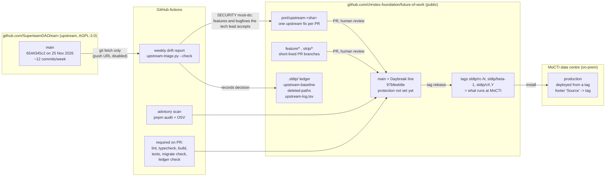
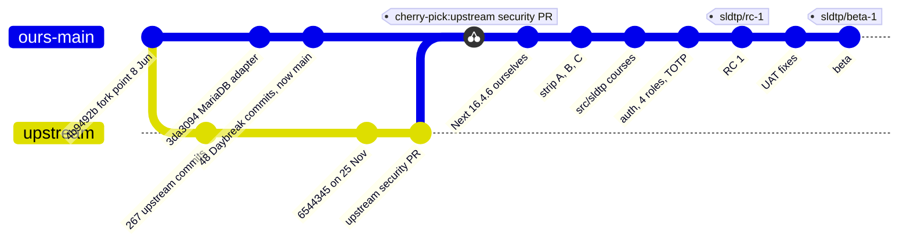

# SLDTP platform: fork and upstream-sync strategy

**Status:** Accepted. Approved by David Ogoo, 27 November 2026. D1 is option (b): no merge of upstream.
**Repo:** `christex-foundation/future-of-work`. It is a public GitHub fork of `SuperteamDAO/earn`, licensed under the GNU AGPL version 3 (the verbatim `LICENSE` file). GitHub records `fork: true` and `parent: SuperteamDAO/earn`.
**Supersedes:** the upstream-sync section of the internal no-Moodle note. This document fills the FND-04, FND-11, FND-12, and GAP-17 placeholders in the engineering plan. Those planning notes are not in this repository.
**Code rules:** [ADR 0002](adr/0002-fork-code-rules.md).

This change is the strategy, the triage script, and a commented deletion ledger. It does not sync upstream, and it does not add CI workflows.

## 0. The decision in one paragraph

The integration line is `main`. It is the Daybreak / Future of Work UI that used to be `redesign`, fast-forwarded onto `main` on 27 November 2026 (`97bfeeb8e`). That tip is 49 commits after the fork point.

Upstream intake for this `main` is **no merge** (D1, option (b), David Ogoo, 27 November 2026). Treat `SuperteamDAO/earn` as an **advisory feed**, not a branch we merge. From the day the strip starts we are a hard fork, and we should say so. We stay *watched*: a script lists every upstream change that touches code we still ship. The triage owner classifies each change. **Security ports are must-do.** Bugfixes in code we still ship, and features worth leveraging for SLDTP, are ported by hand when they serve the LMS and jobs platform. The tech lead decides those. Everything we build lives in `src/sldtp/`. Every deletion is recorded in a ledger the script reads. The database schema is ours from the first migration. The first pass over `4b9492b9d..6544345c2` is [the leverage review](upstream-leverage-review.md).

## 1. Facts this rests on

Checked on 27 November 2026. Upstream `main` is `6544345c26cbd1c16ab99a659b2543dabb6c4a5a` (25 Nov 2026). The fork point on our history is `4b9492b9d4a2cdc2eb3b87e3cb03e78dd1011e2b` (8 Jun 2026).

| Fact | Evidence |
| --- | --- |
| Fork point `4b9492b9d` (8 Jun 2026). Upstream `main` is `6544345c2` (25 Nov 2026), **267 commits ahead**, 394 files changed (+11,146 / −8,311) | `git rev-list --count 4b9492b9d..upstream/main` and `git diff --shortstat` |
| `main` (`97bfeeb8e`) is **49 commits** after the fork point. The first is `3da3094d2` (MariaDB adapter: `src/prisma.ts`, `package.json`, `pnpm-lock.yaml`, `.gitignore`). The other 48 are the Daybreak UI, previously `redesign`. `origin/main` and `origin/redesign` are the same commit | `git rev-list --count 4b9492b9d..origin/main` on 27 Nov 2026 |
| Merging upstream `6544345c2` into current `main` conflicts in **36 paths**. The same merge into `3da3094d2` conflicted only in `pnpm-lock.yaml`. A full merge also brings Next 16.3.8, React 19.3.0, TypeScript 7.0.2, and replaces `clsx` and `tailwind-merge` with the `cn` package. `tsc` was not re-run on the 36-path merge | `git merge-tree --write-tree origin/main upstream/main`, and `package.json` on both tips, 27 Nov 2026 |
| Upstream pace: 95 first-parent changes (PR merges plus direct pushes) in 24 weeks, about **4 a week** | `git rev-list --first-parent --count 4b9492b9d..upstream/main` on 27 Nov 2026 |
| Of those 95, **6** match the security classifier: #1408, #1410, #1416, #1446, `af39bd178`, and #1465. #1408, #1410, and #1446 land in grant or sponsor-dashboard code we delete or rewrite. #1416 also touches `src/pages/api/token-icon.ts` (strip A) and `src/lib/ratelimit.ts` (kept). `af39bd178` is the email rate limit. #1465 edits `next.config.ts`, which stays as a seam | `scripts/sldtp/upstream-triage.py --base 4b9492b9d` on 27 Nov 2026, then `git diff --name-only <sha>^1 <sha>` for each SECURITY row |
| Upstream's busiest paths are `src/pages/api` (64 files), `src/pages/earn` (30), `components/ui`, `sponsor-dashboard`, `features/listings`, and `features/auth`. **These are the same modules we keep and adapt** into opportunities, employer review, and auth | `git diff --stat` by directory |
| Upstream has **no `prisma/migrations`**. It ships schema changes with `db push` to PlanetScale (+392 / −65 schema lines since the fork, about 10 schema commits) | `prisma.config.ts`, `git log -- prisma/schema.prisma` |
| Upstream ships `.github/workflows/lockfile.yml` and `schema-sync-notify.yml` | `git ls-tree upstream/main .github/workflows` |
| Upstream is on Next 16.3.8. That version is still inside GHSA-2464-fhr4-w9xw and GHSA-7qx7-33qx-rqx2. Our target is 16.4.5 or later (16.4.6 is current) | Engineering plan, FND-05 |

### 1.1 The integration line is `main`

Checked the same day, against `origin` and `upstream/main`. GitHub's default branch is `main`. There were no open pull requests. The fork relationship is intact.

`origin/main` was fast-forwarded from `3da3094d2` to `97bfeeb8e`, the tip that had been `redesign`. `origin/redesign` and `origin/main` are that same commit. The integration line is this `main`: the Daybreak work, not the MariaDB-only tip.

`main` has **no branch protection**. The GitHub branch object reports `protected: false`. Section 3 is the protection to turn on. Until it is on, a direct push to `main` is possible.

| Ref | Tip | Date | What it is |
| --- | --- | --- | --- |
| Fork point | `4b9492b9d` | 8 Jun 2026 | Last commit shared with upstream |
| `3da3094d2` | MariaDB adapter | 8 Jun 2026 | First fork commit. This was `main` until the fast-forward |
| `dev` | `45e6db524` | 12 Jun 2026 | 20 Daybreak commits. An ancestor of `main` |
| `main` (formerly `redesign`) | `97bfeeb8e` | 11 Aug 2026 | 49 fork commits. The integration line |

The 49 commits are `3da3094d2` plus 48 Daybreak commits. Against `3da3094d2` those 48 commits change 326 files (+19,678 / −12,274), mostly under `src/components`, `src/features`, and `src/pages`. They do not add `src/sldtp/`. They remove `@radix-ui/react-aspect-ratio`, `d3`, and `@types/d3`, and add `Sponsors.socials`. Forty-six landed in June 2026 and two on 11 August. `dev` is the 12 June prefix of that range.

A content merge of upstream `6544345c2` was checked with `git merge-tree --write-tree`. No commits were created. The table is the evidence for D1. Current `main` is the 36-path row.

| Into | Conflicting paths |
| --- | --- |
| `3da3094d2` (main before the fast-forward) | 1: `pnpm-lock.yaml` only. `package.json` auto-merged. The schema did not conflict |
| `dev` (`45e6db524`) | 22 |
| current `main` (`97bfeeb8e`, formerly `redesign`) | 36, including every `dev` conflict |

The extra 14 paths on current `main` come from Daybreak commits that are not on `dev`. Three of the 36 are modify/delete (deleted on our side, modified upstream): the two home banners and `ListingTable.tsx`. The rest are content conflicts. `package.json` auto-merges, which is how a full merge also takes upstream's dependency bumps. `prisma/schema.prisma` conflicts on `dev` and on current `main`. It did not conflict at `3da3094d2`.

What the 36-path merge actually collides on:

- **Schema.** Our `Sponsors.socials Json?` against upstream `Sponsors.location String?`, in the same slot after `entityName`. The sponsor form and `src/pages/api/sponsors/create.ts` conflict on that same pair.
- **Home listing filter.** `src/features/listings/utils/query-builder.ts`. Our homepage is not filtered by language or reward size. Upstream, for `context === 'home'`, keeps `language` in `eng` or `sco` and applies a USD value floor.
- **Nav, listing, and dashboard UI.** The navbar, earn pages, listing page, listing builder, and sponsor-dashboard files in the list below.

Versions a full merge would bring, against current `main`:

| Package | Current `main` | Upstream `6544345c2` |
| --- | --- | --- |
| `next` | 16.2.1 | 16.3.8 |
| `react`, `react-dom` | 19.2.4 | 19.3.0 |
| `typescript` | 5.8.3 | 7.0.2 |
| Class names | `clsx` ^2.1.1 and `tailwind-merge` ^3.4.0, wrapped in `src/utils/cn.ts` | package `cn` ^0.4.0, `export { cn } from 'cn'` (upstream `f48e297a8`) |

Next 16.3.8 is still inside the advisories in the facts table. We do not take it. The target stays 16.4.5 or later, in our own PR. See the leverage review.

The lockfile-only result describes a merge into `3da3094d2`. It does not describe current `main`.

Conflicts on current `main`:

- `pnpm-lock.yaml`
- `prisma/schema.prisma`
- `src/components/ui/command.tsx`
- `src/components/ui/dropdown-menu.tsx`
- `src/components/ui/select.tsx`
- `src/constants/ST_ROUTES.ts`
- `src/features/feed/components/Feed.tsx`
- `src/features/home/components/SidebarBanner.tsx` (modify/delete)
- `src/features/home/components/SponsorStage/SponsorStageBanner.tsx` (modify/delete)
- `src/features/listing-builder/components/Form/PrePublish/Modal.tsx`
- `src/features/listing-builder/components/Form/TitleAndType.tsx`
- `src/features/listings/components/ListingPage/ExtraInfoSection.tsx`
- `src/features/listings/components/ListingPage/ListingHeader.tsx`
- `src/features/listings/components/ListingsSection.tsx`
- `src/features/listings/utils/query-builder.ts`
- `src/features/navbar/components/DesktopNavbar.tsx`
- `src/features/navbar/components/MobileDrawer.tsx`
- `src/features/sponsor-dashboard/components/GrantApplications/ApplicationDetails.tsx`
- `src/features/sponsor-dashboard/components/GrantApplications/Modals/AiReview.tsx`
- `src/features/sponsor-dashboard/components/GrantApplications/Notes.tsx`
- `src/features/sponsor-dashboard/components/GrantApplications/SelectLabel.tsx`
- `src/features/sponsor-dashboard/components/ListingTable.tsx` (modify/delete)
- `src/features/sponsor-dashboard/components/Submissions/Details.tsx`
- `src/features/sponsor-dashboard/components/Submissions/SelectLabel.tsx`
- `src/features/sponsor/utils/sponsorFormSchema.ts`
- `src/layouts/Feed.tsx`
- `src/pages/_app.tsx`
- `src/pages/api/sponsors/create.ts`
- `src/pages/earn/dashboard/sponsor/edit.tsx`
- `src/pages/earn/index.tsx`
- `src/pages/earn/new/index.tsx`
- `src/pages/earn/new/sponsor.tsx`
- `src/pages/earn/t/[slug]/edit.tsx`
- `src/pages/index.tsx`
- `src/pages/member-perks.tsx`
- `src/styles/st-globals.css`

`dev`'s 22 conflicts are `pnpm-lock.yaml`, `prisma/schema.prisma`, the three `src/components/ui/*` files, both home banners, `ListingsSection.tsx`, both navbar files, `ListingTable.tsx`, `Submissions/SelectLabel.tsx`, `sponsorFormSchema.ts`, `src/pages/_app.tsx`, `src/pages/api/sponsors/create.ts`, the four `src/pages/earn/**` pages in the list above, `src/pages/index.tsx`, and `src/styles/st-globals.css`.

## 2. Where the prior plan was wrong or too optimistic

1. **"After the strip, upstream will mostly touch code we deleted" is false for us.** Upstream's activity is concentrated in listings, sponsor dashboard, API routes, and auth. We keep exactly those and rewrite them into opportunities, employer review, and four-role auth. So the kept files will diverge **fast**, not slowly. Cherry-picks will rarely apply cleanly after week 4. Plan for **porting by hand**.
2. **"Weekly security cherry-picks" overstates the inflow.** At upstream's current pace we should expect about **one relevant security fix a month**. Keep the weekly triage, because it is cheap and automated. Ports themselves are event-driven: a security fix is ported the same week, and bug fixes go in a monthly batch.
3. **"Rebase the fork onto upstream and force-push `main`" buys nothing.** D1 does not merge and does not rebase. On current `main` a merge would have been 36 paths, not one file (section 1.1). That is why it was refused. `3da3094d2` stays reachable.
4. **A pushed `upstream-main` mirror branch is a moving part we don't need.** It needs its own protection, and it invites GitHub's **"Sync fork"** button, which merges upstream into a branch in one click. The remote-tracking ref `upstream/main` plus a committed baseline file (`.sldtp/upstream-baseline`) is enough. Use the GitHub compare URL for browsing.
5. **The GitHub fork link itself is a risk the plan missed.** A PR created from the GitHub UI or `gh pr create` on a fork can default its base to `SuperteamDAO/earn`. One careless click would publish an SLDTP PR, with its description and client context, to Superteam's repo. Detach the fork (decision D4) or at least set `gh repo set-default christex-foundation/future-of-work` on every clone.
6. **Do the Next.js upgrade to 16.4.6 as our own PR.** D1 does not take upstream's Next 16.3.8, React 19.3.0, or TypeScript 7.0.2. Those versions ride inside `6ce3fa6fc`, which also conflicts with Daybreak. 16.3.8 is still inside the advisories above. The old "diff is four MariaDB files" check was for a merge into `3da3094d2` only.
7. **"Take upstream schema changes by hand" is right, and it is incomplete.** Upstream will never give us a migration, so every upstream model change we want is a migration we write. Split the schema into files (section 7.4) so our models never sit in the same file as theirs.

## 3. Branch and remote model





The first diagram is the branch and remote model. Upstream is fetch-only. There is no merge into `main`. The second diagram is that history: Daybreak stays on `ours-main`, and a security fix is ported by hand. There is no `sldtp/sync-0`. In the flowchart node, `&lt;` is the mermaid HTML label for `<`, so the rendered text is `port/upstream-<sha>`. The branch name is `port/upstream-<sha9>`.

`main` has no branch protection today (`protected: false`, 27 November 2026). Turn it on before any further work lands: pull request required, one approving review (two for `prisma/`, auth, `next.config.ts`, and `.sldtp/`), required checks once they exist, no force-push, no deletion. Squash is the default. This recommendation is not applied in this change.

| Ref | Rule |
| --- | --- |
| remote `upstream` = `https://github.com/SuperteamDAO/earn.git` | **Fetch only.** `git remote set-url --push upstream DISABLED` on every clone, CI runner, and agent box |
| `main` | The only long-lived branch. It is the Daybreak line (`97bfeeb8e`, formerly `redesign`). **Protection is not on.** The rule to set: PR required, 1 approving review (2 for `prisma/`, auth, `next.config.ts`, `.sldtp/`), required checks green once CI exists, no force-push, no deletion. Squash is the default. D1 does not add a merge commit |
| `feature/<id>-…`, `strip/A-…`, `strip/B-…`, `strip/C-…` | Short-lived PR branches, one backlog ID each |
| `port/upstream-<sha9>` | One upstream change ported per PR. The PR body links the upstream commit or PR and its triage class |
| `release/<tag>` | Only if a hotfix is needed on what is deployed while `main` has moved on. Branch from the tag, fix, tag `…-1`, merge back to `main` |
| Tags `sldtp/rc-N`, `sldtp/beta-1`, `sldtp/vX.Y` | Annotated and immutable. **Production is only ever installed from a tag.** The footer Source link points at that tag. There is no `sldtp/sync-0` |
| `.sldtp/upstream-baseline` | Full SHA of the last upstream commit we triaged. D1 sets it to the fork point `4b9492b9d`, because nothing upstream has been triaged. The weekly triage PR advances it |
| `.sldtp/deleted-paths` | Deletion ledger (section 7.3). Commented template until the first strip |
| `.sldtp/upstream-log.tsv` | One row per upstream change we decided on: `upstream_sha`, `decision`, `our_sha`, `who`, `note`, separated by tabs |

Retire the old names `sldtp/prod` (use tags) and `sldtp/security` (use `port/upstream-*`).

`redesign` is the old name of this `main`. `dev` is an ancestor (section 1.1). Neither is a second integration line.

## 4. Upstream intake (FND-04): no merge

D1 is option (b). Approved by David Ogoo, 27 November 2026. Do not merge `6544345c2`. The 36-path table in section 1.1 is why: a full merge collides with Daybreak on the schema (`Sponsors.socials` vs `Sponsors.location`), the home listing filter, and nav, listing, and dashboard UI, and it would also take Next 16.3.8, React 19.3.0, TypeScript 7.0.2, and `clsx` / `tailwind-merge` → `cn`.

What we do instead:

- `.sldtp/upstream-baseline` is the fork point `4b9492b9d4a2cdc2eb3b87e3cb03e78dd1011e2b`. Nothing upstream is triaged yet.
- Each week the triage script classifies upstream changes since that baseline. Security is ported the same week. Bugfixes and features are ported by hand only when the tech lead says they serve SLDTP. The first list is [the leverage review](upstream-leverage-review.md).
- Try `git cherry-pick -x` when the files are unchanged since the fork. If Daybreak touched the file, re-implement the fix and add `Ported-from:`.
- Do not take upstream's lockfile, schema, or framework bump.
- There is no `sldtp/sync-0`.

### Historical trial, not the procedure for this `main`

The commands below were a trial merge into `3da3094d2`, when the only conflict was the lockfile and `tsc --noEmit` and `prisma generate` passed after the lockfile was regenerated. They are the wrong commands for current `main`.

```bash
# Trial against 3da3094d2 only. Do not run this against current main.
git merge --no-ff 6544345c26cbd1c16ab99a659b2543dabb6c4a5a
# That tip conflicted in pnpm-lock.yaml only.
# git checkout --theirs pnpm-lock.yaml && pnpm install --lockfile-only
```

## 5. Ongoing intake policy

### Options compared

| Option | How it works | Effect on this fork | Verdict |
| --- | --- | --- | --- |
| A. Regular merges | `git merge upstream/main` every 1–4 weeks | Every merge re-surfaces upstream edits to files we deleted (modify/delete conflicts on hundreds of paths) and to listings, sponsor, and auth files we rewrote. It also brings upstream features, tables, and env vars back in | **No.** Only workable while we are close to upstream, which ends with the strip |
| B. Rebase a patch stack | Keep SLDTP as N commits replayed on upstream | Our patches become thousands of commits: a whole LMS. Replaying them is impossible, and the force-pushes break every clone and every agent's checkout | **No.** Suits a fork with fewer than 20 small patches |
| C. Cherry-pick only | `git cherry-pick -x -m 1 <upstream PR merge>` for chosen fixes | Cheap while kept files look like upstream. Fails more and more once we rewrite them | **Yes, as the first attempt for each port** |
| D. Hard fork, watched upstream, port by hand | Upstream is a feed. The triage script lists relevant changes, and we re-implement the fix in our code with a test | Weekly triage, then a hand port when a security fix applies to code we still ship | **Agreed steady state.** Option C is tried first inside D |
| E. Vendor-and-freeze / unwatched hard fork | Stop looking at upstream | We lose upstream's security fixes in shared code, and those are the only free security review we get | **Not before the triggers below** |

### Recommendation

**D from now, with C as the first attempt for each port.** There is no full merge of upstream, including no `sldtp/sync-0`. Security is ported when it touches code we still ship. A bugfix or a feature is ported only when the tech lead judges that it serves the LMS and jobs platform.

**When to stop watching (switch D → E).** Review at the quarterly fork review (GAP-17). Stop when **any** of the following is true:

- 8 consecutive weekly triages produce no SECURITY or BUGFIX-KEPT row; or
- more than 70% of the kept upstream-origin files listed by `git ls-files` have been moved into `src/sldtp/` or rewritten (the touch-budget report in section 8 measures this); or
- upstream makes a structural change we will not follow, such as a router migration, an auth rewrite, a Prisma major, or a framework swap.

Even after that switch, **someone keeps reading upstream PRs titled security or audit once a month.** This continues until handover to MoCTI and is written into the handover runbook.

**Freeze.** From `sldtp/rc-1` (end of week 8, 28 Feb 2027) to `sldtp/beta-1`, only SECURITY ports rated high or critical land, plus UAT fixes.

### Triage: cadence, owner, classification

- **When:** every Monday, after the scheduled drift job (07:00 Freetown, UTC+0) has produced the report. FND-12 covers a weekly triage. The drift job itself is later work (section 8). It is not in this change.
- **Who:** the triage owner classifies the rows. **Security is must-do.** The tech lead decides which bugfixes and which features to port. The area owner ports. An AI agent may pre-fill the notes (section 10). The backup owner is named outside this document.
- **Output:** one PR, "Upstream triage week N". It appends rows to `.sldtp/upstream-log.tsv` and moves `.sldtp/upstream-baseline` to the SHA triaged. That PR is the audit trail. No issue tracker is needed (issues are disabled; see R13).

| Class (from the script) | Meaning | Default decision | Deadline |
| --- | --- | --- | --- |
| **SECURITY** | Security. Touches a kept path, and the message matches security, auth, rate-limit, sanitise, IDOR, and similar | **Must-do.** Reproduce on our code first. Port it, or record `not-affected` with the reason. The tech lead does not waive a kept-path security fix | Same week. Within 48 hours if it is exploitable without login |
| **BUGFIX-KEPT** | Bugfix in kept code | Port by hand when it serves SLDTP. **The tech lead decides.** Otherwise `skip` | When accepted. Otherwise the monthly review |
| **DEPS** | Only `package.json` or the lockfile | **Information only.** Our dependency policy (section 7.6) decides. We do not take upstream's versions | Not applicable |
| **FEATURE-KEPT** | Feature worth a look. The script cannot know whether it is worth leveraging | Port by hand when it serves the LMS and jobs platform. **The tech lead decides.** Otherwise `skip` | When accepted |
| **MOVED** | Touches upstream code we moved into `src/sldtp/` | Human look: is it a fix or a feature that applies to our copy? Same decision rule as SECURITY or BUGFIX-KEPT | Same as the class it would have had |
| **IRRELEVANT** | Irrelevant. Only deleted paths or brand-new upstream paths | Auto-`skip`. Never resurrect deleted code | Not applicable |

The regex classifier gives a **suggestion, not a verdict**. For example, `#1346 perf/cdn-cache-headers` touched 21 kept files and is not a security fix. The owner overrides it in the log.

### The triage script

`scripts/sldtp/upstream-triage.py` walks upstream and classifies each change. The ledger it reads is [`.sldtp/deleted-paths`](../.sldtp/deleted-paths).

- It walks the upstream **first-parent** history from the baseline, so each upstream PR merge is one row.
- It diffs each change against its first parent and classifies every file as kept (exists in our tree and is not in the ledger), deleted (matches `.sldtp/deleted-paths`), moved (matches an `old -> new` ledger line), or new-upstream.
- It prints a markdown table and exits 1 with `--check` if a kept-path change has no decision in `.sldtp/upstream-log.tsv`.
- Run on 27 November 2026 with `--base 4b9492b9d` and the committed ledger (every glob commented out, so nothing counts as deleted or moved): 95 first-parent commits, 6 SECURITY, 41 BUGFIX-KEPT, 41 FEATURE-KEPT, 7 IRRELEVANT. No DEPS or MOVED rows, and 88 of the 95 are untriaged because `.sldtp/upstream-log.tsv` does not exist yet.
- An earlier sample that treated the draft globs as active reported the same 95 changes as 6 SECURITY, 37 BUGFIX-KEPT, 39 FEATURE-KEPT, 12 IRRELEVANT, and 1 MOVED. That is the shape after a strip PR uncomments the globs. The script only puts work in front of people where we still ship the code.

```bash
git fetch upstream
python3 scripts/sldtp/upstream-triage.py                 # table since baseline
python3 scripts/sldtp/upstream-triage.py --all           # include IRRELEVANT rows
python3 scripts/sldtp/upstream-triage.py --check         # CI mode
```

`.sldtp/upstream-baseline` is the fork point, so a run with no `--base` lists everything upstream since 8 June 2026. `--check` is for the future drift job. This change does not wire it into CI. The classified first pass is [the leverage review](upstream-leverage-review.md).

## 6. Porting a fix: the steps

1. `git switch -c port/upstream-<sha9> main`
2. Try `git cherry-pick -x -m 1 <sha>` for a PR merge, or `-x <sha>` for a single commit. `-x` writes the upstream SHA into our commit message.
3. If it conflicts, apply the decision rules in section 9. Usually you abort and **re-implement the fix by hand**, citing `Ported-from: SuperteamDAO/earn@<sha> (#PR)` in the commit trailer.
4. Add a test. For SECURITY, the test must fail before the fix and pass after it (for example, an unauthenticated request returns 401, or another user's id returns 403).
5. PR, review by the area owner and the triage owner, merge, and fill in `our_sha` in the log.

## 7. Code rules that keep divergence cheap

Accepted in [ADR 0002](adr/0002-fork-code-rules.md). The ADR is the rule. This section is the operating detail, including schema and dependencies, which are decisions D7 and D8 rather than part of the ADR.

### 7.1 Where code goes

- **All new product code goes in `src/sldtp/`**: `courses/`, `quiz/`, `cohorts/`, `certificates/`, `opportunities/`, `employer/`, `auth/`, `hubs/`, `i18n/`, `offline/`, `admin/`. Upstream will never touch this tree, so it never conflicts.
- **Routes:** use App Router groups `src/app/(sldtp)/…` and `src/app/api/sldtp/…`. Add no new files under `src/pages/` or `src/pages/api/`.
- **Adapt by moving, not by editing in place.** If we would change more than about a third of an upstream module (for example `features/listings` → opportunities), `git mv` it into `src/sldtp/`, rewrite it there, and add an `old/** -> src/sldtp/new/` line to the ledger. Small edits (a field or a guard) stay in place under the marker rule below.

### 7.2 Seams, and marking edits to upstream files

Every edit to a file that came from upstream is wrapped and greppable:

```ts
// SLDTP-BEGIN(ADR-0003): replace Privy session with SLDTP session
...
// SLDTP-END
```

A one-line change uses a trailing `// SLDTP(ADR-0003): reason` comment.

The number inside the marker is the ADR for that edit. ADR 0002 is the standing rule. `ADR-0003` in the example is a later, specific decision, not this strategy.

Use a small, fixed set of seams instead of scattered edits:

| Seam | One upstream file touched | Everything else in |
| --- | --- | --- |
| Auth/session | `withAuth` and related helpers call `src/sldtp/auth/session.ts` | `src/sldtp/auth/` (roles, TOTP, guards) |
| Navigation | navbar imports `src/sldtp/nav.ts` | `src/sldtp/nav.ts` |
| Providers (i18n, offline registration, theme) | `src/components/providers.tsx` wraps `SldtpProviders` | `src/sldtp/providers.tsx` |
| Database client | `src/prisma.ts` (already ours since `3da3094d2`) | — |
| Config and headers | `next.config.ts` spreads `sldtpConfig` | `src/sldtp/next.config.part.ts` |
| Branding | theme tokens file | `src/sldtp/theme/` |

The touch-budget report (section 8) counts `SLDTP-BEGIN` markers and changed upstream files per week. If the count grows faster than the seams explain, a reviewer should ask why.

### 7.3 Deletion ledger: `.sldtp/deleted-paths`

- Every strip PR adds the globs it deletes, **in the same commit**. Moves use `old -> new`. The committed file is a commented template of strips A, B, and C plus the two planned moves. Uncomment a line only in the commit that deletes or moves that path.
- CI will enforce it both ways: a file deleted in a PR whose path is not in the ledger fails, and a ledger glob that still matches files in the tree fails. That job is not in this change.
- The ledger also covers non-code items: removed env vars go in `.sldtp/deleted-env` and removed Prisma models are listed in the baseline migration's README. Upstream's `.github/workflows/lockfile.yml` and `schema-sync-notify.yml` go in the ledger too; `schema-sync-notify` posts outside our control, so delete it during FND-02.
- Delete, don't flag. The ledger is what makes deletion cheap at triage time.

### 7.4 Database schema and migrations

- **Split the schema into a folder** (Prisma 7 multi-file schema): `prisma/schema/upstream.prisma` holds the models we kept from Superteam, and `prisma/schema/sldtp/*.prisma` holds courses, quizzes, cohorts, roles, TOTP, and so on. Change `prisma.config.ts` to `schema: 'prisma/schema'`. Back-relations that Prisma forces onto upstream models (for example `User.enrolments`) go in `upstream.prisma` inside `SLDTP-BEGIN` / `SLDTP-END`.
- **Baseline once, after the strip (FND-09):** `prisma migrate diff --from-empty --to-schema prisma/schema --script > prisma/migrations/0000_sldtp_baseline/migration.sql`. From then on, **`prisma migrate dev` / `migrate deploy` only**. `db push` is banned outside throwaway local databases, and CI greps for it in scripts.
- **Upstream schema changes are never merged.** If triage says we want one (rare), we write our own migration with `migrate dev --create-only`, review the SQL by hand (MariaDB, not PlanetScale: foreign keys exist on our side), and test it on a copy of staging data.
- CI check: `prisma migrate diff --from-migrations prisma/migrations --to-schema prisma/schema --exit-code` against a shadow MariaDB. A red check means someone changed the schema without writing a migration.
- Two reviewers are required for `prisma/`.

### 7.5 Tests that make porting safe

Today the repo has no tests. Ports are only safe with three minimum layers, which are already in the plan as AUT-07 and the UAT items:

1. Role-by-route authorisation matrix tests (four roles × every kept API route).
2. Route tests for any upstream route we keep and port fixes into.
3. A Playwright smoke test of the three journeys: learner, employer, and admin.

### 7.6 Dependencies: our own policy, separate from upstream

- **`package.json` is ours.** Upstream version bumps are DEPS rows and information only. We never take upstream's lockfile. Next 16.4.6, and any React or TypeScript move, are our own PRs. See the leverage review.
- Pin exact versions for `next`, `react`, `react-dom`, `prisma`, `@prisma/client`, `@prisma/adapter-mariadb`, and `mariadb`. Pin the Node LTS version in `.nvmrc` and in `engines`, matching the MoCTI VM.
- Critical or high advisory in a shipped dependency: patch PR within 48 hours. Minor versions: one batched PR a month. Majors need an ADR and are not taken after 15 February, before beta.
- Renovate or Dependabot: security updates on, version updates grouped monthly. It never auto-merges.
- After the strip, remove the packages from the deleted subsystems (Solana, Privy, Sumsub, Airtable, BullMQ, and so on) and run `pnpm dlx knip` to find the rest. Every removed package shrinks both the attack surface and the audit noise.

## 8. CI and automation (FND-02, FND-11)

Not in this change. The jobs below are the agreed shape for FND-02. Branch protection on `main` is recommended now, because the branch has none, and it is not turned on here (section 3). The jobs themselves wait for FND-02.

| Job | Trigger | Fails when | Blocks merge? |
| --- | --- | --- | --- |
| `lint` (oxlint), `typecheck` (`tsc --noEmit`), `build` (`next build`) | PR, push to main | Any error | **Yes** |
| `test` (unit, route, and authz matrix; Playwright smoke from week 6) | PR | Any failure | **Yes** |
| `migrations` (`prisma migrate diff … --exit-code` on a shadow MariaDB; grep for `db push`) | PR touching `prisma/` | Schema without a migration | **Yes** |
| `ledger` (deleted files are a subset of the ledger; ledger globs match nothing; SPDX header on new `src/sldtp/` files) | PR | Ledger out of date | **Yes** |
| `audit` (`pnpm audit --prod --audit-level=high` plus `osv-scanner --lockfile pnpm-lock.yaml`) | PR, plus a daily schedule | High or critical in shipped dependencies | **Yes** on PR. The daily run alerts the triage owner |
| `upstream-drift` (fetch upstream; `upstream-triage.py`; write the table to the job summary and as an artifact; touch-budget report) | Monday 07:00 Freetown (UTC+0), plus manual | A SECURITY row untriaged for more than 7 days (`--check`) | No. It is a red scheduled run that the triage owner must clear |
| `agpl` (the built footer contains the Source link; `LICENSE` is present and unchanged) | PR | The link or licence is missing | **Yes** |

Branch protection makes all the "Yes" jobs required. A one-reviewer minimum applies everywhere, and two reviewers for `prisma/`, `src/sldtp/auth/`, `next.config.ts`, and `.sldtp/`, set through `CODEOWNERS`. The drift job uses `actions/checkout` with `fetch-depth: 0` and fetches upstream over anonymous HTTPS. It needs no token with write access to anything.

## 9. Conflict playbook

**Ownership:** whoever owns the area owns the conflict. Record the owners in `CODEOWNERS` when branch protection is set (FND-02). Until then the areas are:

- Auth, `prisma/`, `next.config.ts`, the seams, CI, and `.sldtp/`
- Opportunities, employer, and certificates
- Courses and quiz
- Hubs, i18n, offline, and accessibility

The triage owner only routes.

**Decision rules, applied file by file:**

| Situation | Rule |
| --- | --- |
| Path is in the deletion ledger | **Take ours (stay deleted).** Never restore an upstream file to make a cherry-pick apply |
| Path is under `src/sldtp/` | Cannot conflict with upstream. If it seems to, the ledger move line is wrong |
| Kept file we have **not** changed since the fork point (`git diff 4b9492b9d main -- <file>` is empty) | **Try the cherry-pick.** Daybreak did not touch it |
| Kept file we changed, and the upstream change is a security fix | **Port by hand.** Understand the vulnerability, write the failing test, apply the equivalent fix to our code |
| Kept file we changed, and the upstream change is a bug fix | Port by hand **only if** the bug reproduces on our code |
| Kept file we changed, and the upstream change is a feature | Skip |
| `package.json` / `pnpm-lock.yaml` | **Never take theirs.** Apply our dependency policy, then `pnpm install` to regenerate |
| Prisma schema | Never merge. Write our own migration (section 7.4) |
| `next.config.ts`, security headers, middleware | Merge by hand, then **read the whole resulting file** and run the header check. Upstream both added and later removed headers in the #1346 / #1465 series |

**Tooling:** enable `git config rerere.enabled true` on every clone. It mainly helps when a port PR is rebased several times. Use `git cherry-pick -x` so every port carries its upstream SHA, and write a `Ported-from:` trailer when the fix was rewritten by hand.

**Tests required to merge a port:** the full required CI suite, plus the new failing-then-passing test for SECURITY, plus the Playwright smoke test if the port touches auth, sessions, or headers.

## 10. AI agents in triage and porting

Agents are good at this work: it is high-volume, mechanical, and each step is checkable. The rules:

- **What agents may do:** run the triage script; for each row, read the upstream diff and our current file and write a one-paragraph assessment ("affected / not affected / why") with a proposed decision; open draft `port/upstream-*` PRs that include the test; draft the weekly triage PR.
- **What agents may not do:** push to `main`, merge anything, push to or open PRs or issues on `SuperteamDAO/earn` (the push URL is disabled; see D4), run `db push` against any shared database, or change `.sldtp/deleted-paths` without a human approving the strip PR.
- **Human review:** every agent PR gets the `ai-port` label and is reviewed by the area owner. For SECURITY rows, **the reviewer reads the upstream diff themselves** and does not rely on the agent's summary. The triage owner signs the weekly log PR.
- **Prompt for an agent port.** Put a copy at `scripts/sldtp/port-prompt.md` when the first agent port is set up. The prompt is: "Upstream change `<sha>` classified `<class>`. Our files: `<list>`. Decide whether our code has the same defect. If yes, write a failing test, apply the minimal fix following `docs/fork-and-upstream-sync.md` section 9, and add `Ported-from:`. If no, explain why in two sentences. Do not touch deleted paths. Do not change dependencies."

## 11. Licence obligations (GNU AGPL version 3)

The program is under the GNU Affero General Public License, version 3. The grant is the verbatim [`LICENSE`](../LICENSE) file, which is the FSF text and is unchanged from upstream. Do not edit it.

Checked on upstream `6544345c2` on 27 November 2026:

- No `SPDX-License-Identifier` header appears in `*.ts`, `*.tsx`, `*.js`, or `*.md` on `upstream/main`.
- Source files do not say "or any later version".
- The sentence "either version 3 of the License, or (at your option) any later version" appears only in the "How to Apply These Terms to Your New Programs" appendix of `LICENSE`. That appendix is the FSF's advice for new programs. It is not a later-versions grant on this codebase.
- `package.json` has no `license` field.

New files therefore use `SPDX-License-Identifier: AGPL-3.0-only`, not `AGPL-3.0-or-later`. `scripts/sldtp/upstream-triage.py` already does. FND-03 can revisit the header text. It should not switch the identifier to `-or-later` unless a grant in the repo actually says so.

- **Section 13, the network source offer.** Every page footer has a Source link to the **exact running tag** (`https://github.com/christex-foundation/future-of-work/tree/<tag>`), plus build instructions and an env template with secrets removed. The build injects the tag, so the link cannot drift from what is deployed. If the repo is ever made private, the link must point to a public tarball of that tag instead.
- **Section 5(a), notices of modification.** Add `NOTICE.md`: "SLDTP platform, modified by Christex Foundation from SuperteamDAO/earn (GNU AGPL version 3), modifications since 2026-06-08". The `.sldtp/deleted-paths` ledger and git history document what changed. `NOTICE.md` is not added in this change. `main` carries the MariaDB adapter (`3da3094d2`) and the 48 Daybreak commits through `97bfeeb8e`.
- **Keep** `LICENSE` and every existing copyright notice. New files carry `SPDX-License-Identifier: AGPL-3.0-only` and `Copyright (c) 2026 Christex Foundation`.
- **Trademarks:** remove Superteam and Earn names and logos from the UI (strip B already plans to). The AGPL does not grant trademark rights.
- **Dependencies:** MIT, BSD, Apache-2.0, LGPL, GPL-3.0, and AGPL-3.0 are compatible with distributing this program under the AGPL. No proprietary or SSPL code in the build. Add a licence check to the `audit` job (`pnpm licenses list` against an allowlist).
- **Job matching built inside this fork is AGPL-3.0.** Describing that work as Apache-2.0 would be wrong. The change notice must say it is AGPL-3.0.
- **Handover:** MoCTI becomes the operator and inherits the section 13 obligation. The handover runbook says they must keep the Source link and publish their own changes if they modify and run the code.
- This note is not legal advice. Have counsel glance at the change-notice wording.

## 12. Backlog impact

No effort figures here. The sequencing change is:

- FND-04 is decided: no upstream merge. The remaining work is the ports in the leverage review, security first.
- FND-11 remains the drift job, branch rules, and AGPL hygiene. The triage script is in the repo. The ledger check, the migrations check, `CODEOWNERS`, and the footer are not. Branch protection on `main` is recommended now. The branch has none (section 3).
- FND-12, weekly triage, stays a priority. Security ports are not optional. Bugfix ports stay a monthly batch.
- FND-09, the Prisma baseline, also covers splitting the schema folder.
- GAP-17, the quarterly fork review, first falls in early June 2027 and checks the triggers for stopping the upstream watch.

## 13. Decisions

**Approved by David Ogoo, 27 November 2026, including D1.**

| # | Decision | Outcome |
| --- | --- | --- |
| D1 | Upstream intake for the current `main` | **Option (b). No merge of `6544345c2`.** Port security fixes through the weekly triage, and selectively cherry-pick or hand-port upstream features and patches we can leverage. The tech lead decides features and bugfixes. Security on code we still ship is must-do. The 36-path table in section 1.1 stays as the evidence against a full merge. First list: [upstream leverage review](upstream-leverage-review.md) |
| D2 | Merge or rebase for a one-time sync | **Not used.** D1 does not merge and does not rebase |
| D3 | Steady-state model | **Hard fork with watched upstream.** Weekly scripted triage. Security is ported. Features and bugfixes are ported by hand when they serve SLDTP. No full merges. Review the stop-watching triggers quarterly |
| D4 | Detach the GitHub fork relationship from `SuperteamDAO/earn` | **Yes.** D1 is settled. Use GitHub's leave-fork-network setting or ask GitHub Support. This prevents accidental PRs to Superteam's repo. `git fetch upstream` keeps working |
| D5 | Who owns weekly triage | **A named triage owner, with a named backup.** Agents pre-fill. Humans decide and sign the log. Names are kept outside this repository |
| D6 | Code rules: `src/sldtp/`, the seams, the `SLDTP-BEGIN` / `SLDTP-END` markers, adapt-by-move, the deletion ledger | **Yes.** Recorded in [ADR 0002](adr/0002-fork-code-rules.md) |
| D7 | Database: split schema folder, baseline migration after the strip, `db push` banned outside local throwaway databases | **Yes** |
| D8 | Dependency policy independent of upstream: exact pins, 48-hour security patches, no majors after 15 February. Next >= 16.4.5 in our own PR | **Yes.** Do not take upstream's Next 16.3.8, React 19.3.0, or TypeScript 7.0.2. React 19.3 only if the Next PR needs it. TypeScript 7 is not worth it now. Detail is in the leverage review |
| D9 | Required CI checks and branch protection as in section 8 | **Yes.** `main` currently has no branch protection. Turn that on. Squash is the default. The CI jobs themselves are FND-02 and are not in this change |
| D10 | Contribute anything back to Superteam (for example a `DATABASE_ADAPTER=mariadb` switch) | **Not before March.** Revisit at the June review. There is little to gain while we diverge |

## Appendix: files in this repository

- `docs/fork-and-upstream-sync.md` (this document)
- `docs/upstream-leverage-review.md`
- `docs/adr/0002-fork-code-rules.md`
- `scripts/sldtp/upstream-triage.py`
- `.sldtp/deleted-paths` (commented template; nothing deleted yet)

Not in this repository: rendered diagram images, the sample triage table, `.sldtp/upstream-log.tsv`, `NOTICE.md`, and CI workflows. `.sldtp/upstream-baseline` is the fork point.

**Unverified here:** `next build`, `tsc --noEmit`, and a running app on a merge into current `main` (the earlier trial ran `tsc --noEmit` and `prisma generate` only, and only against `3da3094d2`); whether GitHub currently offers self-service fork detachment for this org; the classifier's precision on future upstream commits. The SPDX finding in section 11, the 36-path conflict set, the dependency versions, and `protected: false` on `main` were checked on 27 November 2026.
